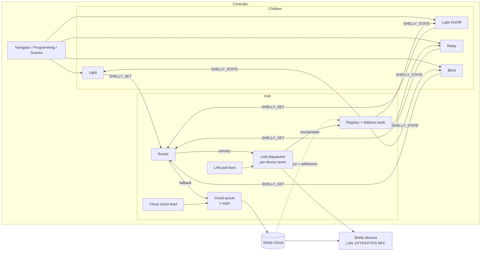
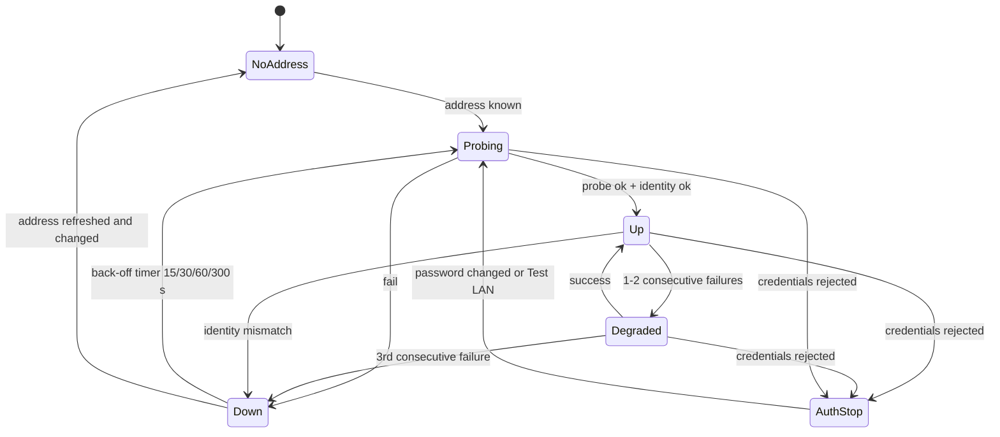
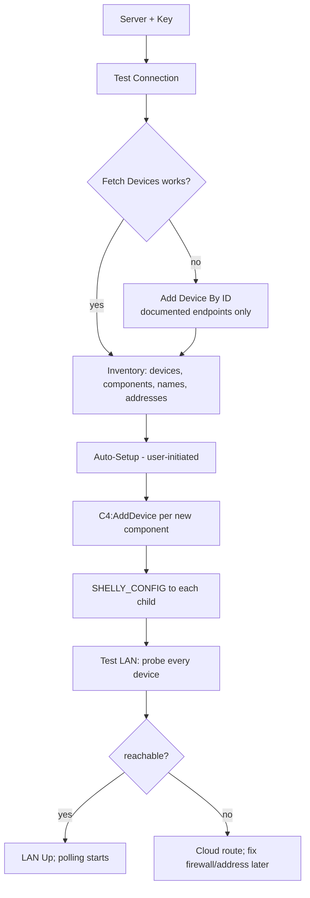

> **Implementation status (2026-09-30):** this document is the design agreed before the build. The code differs in a few
> places - see [IMPLEMENTATION-NOTES.md](IMPLEMENTATION-NOTES.md), which wins where they disagree. Passages that changed carry an
> *Implementation note*.

# Architecture and design notes

How this driver set is meant to work internally, and why it is built the way
it is. Requirements live in [SPEC.md](SPEC.md); this document is the reasoning
behind them.

> **Status: design, not yet built.** Written before the code so the reasoning
> exists first. Two kinds of section appear:
>
> - **Decision** — a choice, with the alternative and the failure it avoids.
> - **Anticipated failure** — a way this class of driver is known to go wrong,
>   with the guard planned for it. Each becomes a named regression test (see
>   *Testing*). When a real field failure occurs, it is added to the same
>   section with its symptom, so a later change does not quietly undo the fix.
>
> Many guards are lifted from the C4-PimaForce driver, where they were learned
> from field failures rather than guessed. They are marked *(from PimaForce)*.

For installation and configuration see the README (written after M4).

## Contents

- [Repository layout](#repository-layout)
- [What is verified, and what is not](#what-is-verified-and-what-is-not)
- [System overview](#system-overview)
- [Cloud provisions, LAN executes](#cloud-provisions-lan-executes)
- [Transports and the router](#transports-and-the-router)
- [The LAN transport](#the-lan-transport)
- [LAN authentication and lockout safety](#lan-authentication-and-lockout-safety)
- [Scheme, TLS and firmware variation](#scheme-tls-and-firmware-variation)
- [Identity: never talk to the wrong device](#identity-never-talk-to-the-wrong-device)
- [The per-device LAN state machine](#the-per-device-lan-state-machine)
- [Address book](#address-book)
- [The cloud transport and its queue](#the-cloud-transport-and-its-queue)
- [Feedback: two schedulers](#feedback-two-schedulers)
- [State model and reconciliation](#state-model-and-reconciliation)
- [Hub ↔ child protocol](#hub--child-protocol)
- [Setup flow](#setup-flow)
- [When a device's address changes (DHCP)](#when-a-devices-address-changes-dhcp)
- [Child event model and proxy conformance](#child-event-model-and-proxy-conformance)
- [Blinds](#blinds)
- [Error handling](#error-handling)
- [Persistence](#persistence)
- [Logging, redaction and diagnostics](#logging-redaction-and-diagnostics)
- [Properties panel discipline](#properties-panel-discipline)
- [Init budget](#init-budget)
- [Security properties](#security-properties)
- [Testing](#testing)
- [Known limitations and good v2 candidates](#known-limitations-and-good-v2-candidates)
- [Building](#building)

## Repository layout

```
C4-ShellyHybrid/
  README.md
  docs/
    SPEC.md               requirements
    ARCHITECTURE.md       this file
    API-NOTES.md          what Shelly really returned (from M0), with fixtures
    COMPOSER-GUIDE.md     source of the Documentation tab in each driver
  src/
    common/               shared Lua, copied into every .c4z at build time
      log.lua             levels, redaction, Recent Activity, LogBlock
      persist.lua         blob persistence with delayed verification (from PimaForce)
      setprop.lua         SetProp(): write a property only if it changed (from PimaForce)
      json.lua            thin wrapper over C4:JsonEncode / JsonDecode
      protocol.lua        hub<->child message names and payload shapes
      ids.lua             reserved event/variable ID ranges; the ONLY place IDs are defined
      childcore.lua       shared child lifecycle: register, state cache, offline debounce, driver events
    hub/
      driver.lua          hub logic
      registry.lua        devices, components, children
      addressbook.lua     address, source, scheme, identity, LAN state per device
      router.lua          chooses LAN or cloud per command
      transport/
        cloud.lua         the only file that knows Shelly cloud URLs and payloads
        cloudqueue.lua    rate gate, priority, coalescing, batching (cloud only)
        lan.lua           the only file that knows device RPC methods and payloads
        lan_dispatch.lua  per-device lanes, global concurrency cap, coalescing
        lan_auth.lua      SHA-256 digest, challenge cache, lockout guard
        lan_scheme.lua    HTTP / redirect / HTTPS detection
      feed/
        lan_poll.lua      staggered LAN reads (a "Feed")
        cloud_check.lua   slow health/address cycle, and fast cycle for Cloud-route devices
    light/  light_onoff/  relay/  blind/
      driver.lua          one small file each: hub messages + command handling
      proxyglue.lua       the ONLY file that talks to that child's proxy (notifications out)
  tools/
    gen_driver_xml.py     generates every driver.xml. Edit this, never the XML
  tests/
    fixtures/             captured payloads (from M0), one file per case
    mock_c4.lua           mocked Control4 runtime, fake clock, fake URL API
    proxy_doubles/        recording doubles for light_v2, blind and relay: log every
                          notification in order, and fire the proxy's own events the
                          way the documentation says it does
    test_cloud.lua  test_lan.lua  test_router.lua  test_auth.lua
    test_parse.lua  test_hub.lua  test_children.lua
    test_regressions.lua  one test per defect class, named for the failure
    profile_director_calls.lua   counts blocking Director calls per operation
  build.sh
  dist/*.c4z
```

**Decision — shared code is copied, not linked.** Each `.c4z` must be
self-contained, so `build.sh` copies `src/common/` into every package and each

> *Implementation note:* each driver is one generated `driver.lua` with all modules embedded behind a private `require`; `tools/spec.py` + `tools/build.py` replace `gen_driver_xml.py` and the copy step.
driver `require`s it from inside its own archive. One giant `driver.lua` per
driver, as PimaForce does, works for a single driver but would mean five copies
of the logger and persistence code kept in sync by hand. Whether `require` of
bundled files behaves identically on every target OS is an **M0 check**; if
not, `build.sh` concatenates instead and nothing else changes.

**Decision — one driver.xml generator**, as in PimaForce, checked for staleness
in CI.

## What is verified, and what is not

Nothing in this repository has run against Shelly hardware or a Shelly account
yet.

**From Shelly's published documentation:** the v2 cloud endpoints and body
shapes; the 1 request/second cloud limit; the ≤ 10 devices per read call; the
cloud error table; that the key and server come from the app; that the
real-time cloud WebSocket needs OAuth; that Gen2+ devices accept JSON-RPC over
HTTP and WebSocket; that access is protected by SHA-256 digest authentication
when enabled, with `Shelly.GetDeviceInfo` and `/shelly` exempt; that the cloud
status sample carries a Wi-Fi block with `sta_ip`; that a device allows six
simultaneous non-persistent RPC channels.

**From community tooling, not Shelly:** that the cloud rejects bursts with 429
and ~1.2 s is a safe spacing; that `/interface/device/list` and
`/device/all_status` work with an authorization key; that OAuth tokens for the
DIY client last 12 hours.

**Reported inconsistently between Shelly sources — treat as unknown:** *when*
devices enforce HTTPS. One Shelly guide attributes HTTPS enforcement, port-80
redirects, private-CA certificates, a 15-minute unauthenticated setup window
and failed-login back-off to firmware 1.8; Shelly's HTTPS page and Home
Assistant place enhanced security in firmware 2.0.0, and say devices merely
updated to 2.0.0 keep serving plain HTTP by default. The whole scheme-detection
design below exists because of this. **No LAN code should be written against
one reading of it until M0.**

**Read from Control4's proxy documentation, not yet exercised on a controller:** the Light V2, Blind and Relay event, variable and notification tables that the child drivers are built against (SPEC §8.3). The test doubles encode that reading and cannot prove the real proxy agrees.

**Not known at all:** every round-trip time; controller CPU cost of decoding
`Shelly.GetStatus`; whether `C4:url` does SHA-256 digest, private-CA TLS, or
custom CAs; digest field details on old vs new firmware; the Ethernet address
field in cloud status; whether `Light.Set` takes a transition duration; the
Light V2 / Relay / Blind notification names. M0 exists to turn these into
fixtures.

The general posture, inherited from PimaForce: **refuse to guess.** An unknown
value is reported unknown; a request that was sent or accepted is not reported
as having worked.

## System overview



Children are thin: proxy traffic in, device-independent intents out; state in,
proxy notifications out. **All Shelly knowledge is in the hub, and it is split
across exactly two files: `cloud.lua` (cloud) and `lan.lua` (device RPC).**

## Cloud provisions, LAN executes

**Decision.** The cloud is used for what it is good at — one credential,
inventory, names, addresses, reachability from anywhere — and the LAN for what
it is good at: speed, no account-wide rate limit, and independence from the
internet.

Consequences that shape everything below:

- The cloud's 1 req/s limit stops being the architecture's ceiling. It now
  governs setup, refresh, health checks and *fallback*, which are rare.
- Steady-state operation needs **no internet**, but only because the address
  book is persisted (*Address book*).
- Two transports means two failure families and a router that must never
  double-apply or mis-route a command. The rule that makes routing safe is
  that **every command is an absolute set** — nothing relative, no toggles
  reach a transport.

**Anticipated failure — "fallback" silently becomes the main path.** If LAN is
broken for a device (a firewall rule, a wrong VLAN), everything still works
through the cloud, and nobody notices until the cloud limit or an outage bites.
Guard: the route is surfaced per child (**Route**), on the hub (**LAN Status**
counts), in **Last Command Result** ("via cloud"), and **Test LAN** gives the
installer a per-device answer at handover. A test asserts every fallback logs
once per transition, not once per command.

## Transports and the router

Both transports implement one interface, so the router and everything above it
is transport-agnostic:

```
transport.set(kind, target, intent, cb)   -> cb(outcome)
transport.read(targets, cb)               -> cb(ok, normalisedDevices | err)
outcome = { ok=true } | { ok=false, class="AUTH"|"UNREACHABLE"|"DEVICE"|"CLOUD"|"RATE"|"CONFIG", reason=... }
```

`intent` is always absolute: `{ on=true }`, `{ on=true, level=60 }`,
`{ position=40 }`, `{ cover="open" }`. Normalised device records are
independent of Shelly's JSON:

```
{ id="b48a0a1cd978", model="SNSW-001P16EU", gen=2, online=true,
  identity={ id="shellyplus1pm-b48a0a1cd978", mac="B48A0A1CD978" },
  components = {
    { kind="switch", channel=0, on=true },
    { kind="light",  channel=0, on=true, level=60 },
    { kind="cover",  channel=0, state="opening", position=40, calibrated=true },
  } }
```

Anything unrecognised becomes `{ kind="unsupported", key=… }` and is preserved,
never dropped or guessed. A field named but empty is `nil` — **unknown, not
off** — the rule PimaForce learned when an unrecognised system key was treated
as "Disarmed" and could show an armed house as disarmed.

### Router

```mermaid
flowchart TD
  A[intent for device D] --> B{LAN enabled and\nD has address and\nLAN state not Down/AuthStop?}
  B -- yes --> C[LAN dispatcher]
  C -- ok --> V[verification read via LAN]
  C -- UNREACHABLE --> F{Cloud fallback on,\ncloud Connected,\ncloud says D online?}
  C -- AUTH --> S[auth stop for D]\n--> F
  C -- DEVICE error --> E[report; no fallback]
  B -- no --> F
  F -- yes --> Q[cloud queue] --> V2[verification read via cloud]
  F -- no --> X[fail with reason]
```

Rules:

1. **LAN first** whenever the device's LAN state permits.
2. **Fallback only for failures where the command may not have been applied
   or where the device never answered** (`UNREACHABLE`, `AUTH`). Because the
   command is an absolute set, a duplicate application after an ambiguous
   timeout is harmless.
3. **A device that answered with an error (`DEVICE`) is never failed over.**
   It reached the device and the device said no — a bad channel or wrong
   profile. Trying the cloud would only hide a configuration mistake and add
   traffic.
4. **AUTH does fall back**, but with a message that says why. An installer
   whose password is wrong should see "LAN authentication failed" rather than
   a mysteriously "working" system.
5. The router decides once per command; it never sends to both transports.

**Anticipated failure — the double-send.** A LAN command times out *after* the
device applied it; the router falls back; the cloud applies it again. With
absolute sets this is idempotent, which is exactly why toggles and relative
moves are banned upstream. A test drives "LAN times out then cloud succeeds"
and asserts that the final device state equals the requested one and that
`toggle` never appears on either wire.

**Anticipated failure — cover commands are not quite idempotent.** `open`,
`close` and `GoToPosition` are absolute; a *stop* followed by a duplicate *open*
could restart travel. Stop is therefore never failed over after a LAN timeout
without a verification read of cover state first (which usually resolves it).
The blind section covers the details.

## The LAN transport

`transport/lan.lua` speaks Gen2+ RPC over HTTP(S).

- **Requests:** `POST <scheme>://<address>/rpc/<Method>` with a JSON body.
  **Decision:** never the query-string form — parameters stay out of URLs and
  logs, and structured params (`Light.Set` with several fields) stay
  well-formed.
- **Timeouts:** short — 3 s connect+response as a starting value
  **[Unverified; tune in M0]**. A LAN device that does not answer in a few
  seconds is not going to; waiting longer only delays fallback.
- **Methods:** `Switch.Set`, `Light.Set`, `Cover.GoToPosition`/`Open`/`Close`/
  `Stop` for control; `Shelly.GetStatus` for feedback; the unauthenticated
  `/shelly` (or `Shelly.GetDeviceInfo`) for probes.

### Dispatcher

`lan_dispatch.lua` owns **lanes**, one per device:

- **One in-flight request per device.** Shelly documents six simultaneous
  non-persistent RPC channels per device, shared with the Shelly app, scripts
  and any other integration. Using one leaves headroom for the others.
- **Global cap of three in flight** across the hub, bounding controller CPU
  and socket use **[Decision]**.
- **Waiting work per lane** is at most one entry per `(kind, channel, field)`,
  so coalescing is a property of the data structure: a slider drag overwrites
  the waiting value, and never queues forty requests.
- **Priority within a lane:** control before verification before polling.
  A control entry never waits behind a poll for the *same* device; a poll
  already in flight is allowed to finish (bounded by the timeout).
- **Fairness across lanes:** round-robin, so a scene touching twenty devices
  starts them in order and none is starved by a chatty one.

This is what turns a scene from "N × 1.2 s" (cloud) into "N ÷ 3 × round-trip".

**Anticipated failure — the poll stampede.** Firing all devices' polls at the
same instant every interval produces a CPU spike on the controller that
starves Director (PimaForce and, per its documentation, Chowmain both saw
periodic CPU spikes from synchronised cloud syncs). Guard: polls are
staggered, `interval / deviceCount` apart, with each device's phase fixed at
start-up plus a small jitter.

**Anticipated failure — a slow device holds a global slot.** With a global cap
of three, three unresponsive devices could pin every slot for a full timeout
each cycle and delay healthy devices. Guard: Down devices are not polled at
the normal rate (they use the back-off schedule), and a per-device timeout
budget means a device that times out is removed from rotation quickly (state
machine below). A test runs one healthy device beside three black-holed ones
and asserts the healthy device's latency stays within a bound.

## LAN authentication and lockout safety

**Digest, SHA-256.** Per Shelly's documentation, protected devices challenge
with a 401 and a `WWW-Authenticate: Digest` header (`qop="auth"`,
`algorithm=SHA-256`, realm = device identifier). The client answers with
`Authorization: Digest username="admin", realm, nonce, uri, cnonce, nc, qop,
response, algorithm`, where

```
HA1      = SHA256(username ":" realm ":" password)
HA2      = SHA256(method ":" uri)
response = SHA256(HA1 ":" nonce ":" nc ":" cnonce ":" qop ":" HA2)
```

(RFC 7616). `lan_auth.lua` implements this over `C4:Hash("SHA256", …)`. Whether
`C4:url` implements digest itself is **[Unverified]**; not relying on it also
keeps behaviour identical across OS versions. The pre-2.0.0 "legacy"
challenge/response differs; supporting it is a fixture-driven M0 task.

**Flow.** First request to a device whose `/shelly` probe said auth is enabled
goes *with* a cached nonce if one is fresh; otherwise it is sent
unauthenticated, receives the 401 challenge (normal — **not a failure**), and is
retried once with credentials. The nonce, realm and a counter `nc` are cached
per device so subsequent requests do not double the round trips.

### Lockout safety

Shelly's network guide describes exponential back-off after failed logins
(10 s → 30 s → 60 s → 5 min), rate limiting and account lockout on newer
firmware. A driver that retries a wrong password on a poll cycle could lock a
device out of its owner's own app.

**Anticipated failure — the retry storm on a wrong password.** Three devices
with the wrong password, polled every 20 s, would keep failing and back-off
would keep growing, until the installer cannot log in either. Guards, all
mandatory:

1. **Distinguish the two 401s.** A 401 to a request that carried no
   credentials is a challenge. A 401/403 to a request that *did* carry
   credentials is a rejection.
2. **On rejection, stop immediately for that device**: no retry, no re-probe
   with credentials, until the password property changes or **Test LAN** is
   run. The device state becomes `AUTH_STOP`. One log line; one event
   (*Device Authentication Failed*).
3. **Never send credentials from a poll to a device already in `AUTH_STOP`.**
   Polls to such devices use the cloud feed.
4. **One attempt with a given password per device per property change.** If
   the same wrong password is re-entered, it is a new attempt; a driver reload
   is *not* a new attempt (the auth-stop is persisted with a hash of the
   password that failed).
5. **A shared Device Password is tried against a device once.** A hub-level
   password wrong for all devices costs one attempt per device, not one per
   poll.

Tests: `wrong_password_is_tried_once_per_device`,
`challenge_401_is_not_a_failure`, `auth_stop_survives_reload`,
`no_credentials_sent_to_auth_stopped_device`.

## Scheme, TLS and firmware variation

Sources disagree on which firmware enforces HTTPS and whether updated (as
opposed to factory-new) devices do. So the LAN transport must handle every
combination, and **detection replaces configuration**:

```
for a device with a known address:
  1. try the remembered scheme (persisted per device)
  2. else http://addr/shelly     -> if 200: scheme=http
                                   if 30x to https: scheme=https (follow, remember)
                                   if refused: try https://addr/shelly
  3. record { scheme, authRequired, identity, fwVersion }
```

**Decision — probe with the unauthenticated endpoint.** `/shelly` and
`Shelly.GetDeviceInfo` are documented as exempt from authentication, so
probing cannot count as a failed login, works on both firmware families, and
yields identity and whether auth is required in one request.

**TLS verification on the LAN** is off by default (property **LAN TLS
Verification**). The reasoning: Shelly's per-device certificates come from a
private CA the controller does not trust; requiring verification by default
would make every new-firmware device unreachable on day one. The cost is that
encryption is not paired with device authentication, so an on-path attacker on
the LAN could impersonate a device. That is the same exposure plain HTTP has
today and is stated in the README. Installers who can arrange trust can turn
verification on. **Cloud connections are always verified** — there the trust
store is public.

**Anticipated failure — a firmware update changes the scheme under us.** A
device updated overnight starts redirecting port 80 to 443. Guard: a refused
connection or a redirect on a remembered scheme triggers a re-detect rather
than a failure; the new scheme is persisted. Test:
`scheme_change_after_firmware_update_is_redetected`.

**Anticipated failure — a redirect loop or cross-host redirect.** Redirects are
followed only to the *same host* and only from `http` to `https`, at most once
per detection. A redirect anywhere else is treated as Down with the reason
logged; otherwise a hostile or misconfigured device could steer credentials
elsewhere.

## Identity: never talk to the wrong device

The nastiest LAN bug is a right command to the wrong device: DHCP hands a
device's old address to another Shelly, and "turn off the kitchen" switches
off the pump.

Guards, in order of strength:

1. **DHCP reservations**, strongly recommended in the README — the real fix.
2. **Identity on every read.** `Shelly.GetStatus` and the probe both carry the
   device's identity (MAC/ID fields **[Unverified]**). Every LAN read is
   compared with the expected identity; mismatch → `DOWN`, discard the
   address, force a cloud address refresh, log at Warning naming both
   identities.
3. **Authentication makes it self-checking.** The digest realm is the device
   identifier, so a device that is *not* the expected one rejects (or
   challenges with a different realm) — the driver notices the realm change
   before sending a command with credentials.
4. **Verification age gate for unauthenticated devices.** A device with auth
   off is identity-checked by reads only, so a command can be sent up to one
   poll interval after a reassignment. To bound it, the hub refuses a command
   if the device's last identity match is older than 3× the LAN poll interval
   and instead runs a probe first (one extra round trip, only in that rare
   case). **Decision:** this trades a little latency on stale addresses for
   safety.
5. **Strict mode.** The hub property **Identity Check = Strict** removes the
   window entirely: every command not preceded by an identity match in the last
   2 s triggers a probe first. The probe is unauthenticated (it cannot trip a
   failed-login counter) and safe to repeat, so the only cost is one extra LAN
   round trip on the first command of a burst. Recommended for anything where a
   mistaken switch matters and the device has no password.

**Anticipated failure — a reassigned address masquerades as a healthy device.**
Test: `reassigned_address_is_detected_before_command_when_stale`,
`identity_mismatch_discards_address_and_refreshes_from_cloud`.

## The per-device LAN state machine



- **Up:** LAN command path, LAN polling.
- **Degraded:** LAN still tried (one retry for absolute sets); commands may
  fall back on failure; polling continues.
- **Down:** no LAN commands, no LAN polling; commands use the cloud if
  allowed; the cloud check feed polls this device at the faster interval;
  re-probe on back-off. On entry, request an address refresh from the cloud.
- **AuthStop:** as Down, except no re-probe *with credentials* until the
  operator acts. (Unauthenticated probes remain safe.)
- **NoAddress:** cloud route only until an address arrives from the cloud or an
  override.

Counters reset on any success. All timers use the injectable clock; a
backwards step is treated as "just now" *(from PimaForce's link watchdog)*.

## Address book

`addressbook.lua` holds, per device:

```
{ id, address, source="cloud"|"override", scheme, authRequired, identity,
  lanState, failures, lastOk, lastIdentityOk, authStopHash, fw }
```

- **Persisted**, using the blob scheme in *Persistence*, so a rebooted
  controller has every last-known address *before any network is available*.
  This is what makes "internet down + controller reboot = LAN still works"
  true. It is the property most easily lost by a careless refactor, so it has
  its own acceptance criterion (SPEC §13.4) and test.
- **Override wins** over the cloud's value and is never overwritten by a
  refresh. A refresh that disagrees with an override is logged once.
- **Source of truth for ownership** stays with the children (they store their
  own device ID, component and channel in properties); the address book is a
  cache of *where*, not *what owns what*.

**Anticipated failure — a stale address survives a router change.** The whole
site is renumbered; every persisted address is wrong. Guard: nothing is
trusted without a successful identity-checked probe. All devices go
`Probing → Down` within one cycle, the cloud refresh is requested for each (the
cloud queue paces it), and addresses heal in roughly `deviceCount × 1.2 s`. A
test renumbers a scripted 40-device site and asserts recovery without any
wrong-device command.

## The cloud transport and its queue

`transport/cloud.lua` is the only file that knows cloud URLs. The behaviour of
`cloudqueue.lua` is the design from the cloud-only version, now carrying far
less traffic: setup, address refresh, the slow health cycle, the faster cycle
for Cloud-route devices, and fallback commands.

- **Rate gate:** one request in flight; ≥ 1.2 s between starts; injectable
  clock.
- **Priority:** Control (fallback commands) → Verify → Background (health,
  refresh, Fetch, Test Connection). A poll cycle outstanding beyond 3× its
  interval is promoted once so control traffic cannot starve it.
- **Coalescing** per `(deviceId, kind, channel, field)`; only ever applied to
  absolute values.
- **Batching:** identical fallback commands to several targets of one kind
  merge into a `set/groups` request; HTTP 200 with `failedCommands` is
  partial failure and resolved per target.
- **Back-off:** 429 → 5/10/20/60 s for the whole cloud queue, reset on
  success. Cloud 401/403 stops the queue until the key changes — and **LAN
  keeps working**.
- **Bounded:** 50 entries; overflow drops oldest Background, then Verify;
  Control overflow fails loudly *(from PimaForce)*.
- **Host pinning:** `*.shelly.cloud` only, checked at entry and again at use.
- **The key never appears in a log line**; URLs are never logged.

Because the cloud path is no longer the primary path, a bug here mostly
affects setup and degraded operation — but that is precisely when an installer
is watching, so the guards stay.

## Feedback: two schedulers

**Decision — feedback is separated from transport.** A `Feed` produces
normalised device reads and knows nothing about routing; two exist now, a third
(WebSocket push) later:

| Feed | Source | Cadence | Covers |
| --- | --- | --- | --- |
| `lan_poll` | `Shelly.GetStatus` per device | LAN Poll Interval (20 s), staggered | Devices with LAN state Up/Degraded |
| `cloud_check` slow | `POST /v2/devices/api/get`, ≤ 10 ids | 300 s | All devices: online flag, address freshness |
| `cloud_check` fast | same | 60 s | Devices whose route is Cloud only |
| *(future)* `lan_push` | WebSocket `NotifyStatus` | event-driven | Up devices |

`lan_poll` details:

- One request per device, spread evenly across the interval; phase fixed per
  device with jitter.
- **Cover in motion** shortens that device's interval to ~1–2 s until stopped
  (bounded to three moving covers at once).
- **After a command,** one verification read ~500 ms later; several commands to
  one device share one verification.
- **Skipped, not stacked:** a device whose previous read is still in flight is
  skipped this round.
- **CPU:** decoding a full `Shelly.GetStatus` for many devices is the main
  controller-load risk of the whole design. M1 measures it. If it is too
  heavy, the fallback is per-component `*.GetStatus` calls (smaller, but more
  of them) or a longer interval; the interface does not change.

`cloud_check` also refreshes addresses: the health cycle compares the
cloud-reported address to the address book and updates it if the LAN path is
Down or the address differs *and no override is set*.

**Why keep a slow cloud cycle at all?** It is the only signal that a
LAN-unreachable device is actually *online* (so the fallback is worth trying),
and it catches address changes on devices that are still answering at their old
address (rare, since that means the address was reassigned — the identity
guard covers that case first).

## State model and reconciliation

The hub holds the authoritative view; children hold a copy for the proxy.

```
Component state = {
  value        -- normalised value, or nil (unknown)
  source       -- "lan" | "cloud" | "optimistic"
  at           -- monotonic time of last confirmed read
  online       -- true | false | nil
  hold         -- { value=…, until=… } after a control command, else nil
}
```

**Optimistic update, then confirmation.** A successful control call updates
the component (`source="optimistic"`) and sets a `hold`. The verification read
replaces it with what the device reports.

**Anticipated failure — the flip-flop.** A poll already in flight when a
command completes returns the *old* value; applying it turns the light back
off in Navigator and then on again at the verification read. Guard: while
`hold.until` has not passed, a read that disagrees with `hold.value` is
ignored (Debug log). The hold is short on the LAN (about 2 s for lights and
relays, since verification is fast) and longer for covers (until estimated end
of travel plus margin, or a stopped read). After expiry the next read is
believed unconditionally.

**An accepted request is not proof it worked** *(from PimaForce, where a
bypass the panel ACKed did not apply)*:

| Outcome | Meaning |
| --- | --- |
| Confirmed | Verification read agrees |
| Disagrees | Read differs after the hold → child corrected to the device's value, Warning logged |
| `UNVERIFIED` | Verification read failed or never ran; optimistic state kept and marked, not silently promoted |

**Unknown is a real state.** After start-up, reload, auth stop, or a Down
device with no cloud read, values are `nil` and children show Unknown/Offline.
A test loads the hub with no connectivity and asserts no child ever published
"off".

**De-duplication:** proxy notifications and property writes only on change
*(from PimaForce: a 20-event burst cost 26 property writes instead of 140)*.

## Hub ↔ child protocol

**Decision — `SendToDevice` plus configuration push, not bindings.** Whether
`C4:Bind` can create hub↔child bindings from Lua is unconfirmed, and hand-wiring
dozens of bindings in Composer would defeat Auto-Setup. The cost is the missing
visible connection line in Composer. All of it is isolated in `protocol.lua`,
so moving to bindings later changes one file.

Parameters are flat strings; nested data is a JSON string in one parameter.

| Direction | Message | Purpose |
| --- | --- | --- |
| Hub → child | `SHELLY_CONFIG` | `HUB_ID, SHELLY_ID, COMPONENT, CHANNEL, NAME, MODEL` after `AddDevice` |
| Child → hub | `SHELLY_REGISTER` | Sent at init; retried every 10 s until acknowledged |
| Hub → child | `SHELLY_ACK` | Accepted, or `UNKNOWN_DEVICE` |
| Child → hub | `SHELLY_SET` | Intent: `SHELLY_ID, COMPONENT, CHANNEL, FIELDS(json), REQUEST_ID` |
| Hub → child | `SHELLY_RESULT` | `REQUEST_ID, OUTCOME, REASON, ROUTE` |
| Hub → child | `SHELLY_STATE` | `ONLINE, VALUE fields, SOURCE, AGE, ROUTE` |
| Hub → child | `SHELLY_HUB_STATUS` | Cloud and LAN summary |
| Child → hub | `SHELLY_UNREGISTER` | From `OnDriverDestroyed` |

**Anticipated failure — boot order.** Children may initialise before the hub.
Registration retries until acknowledged; the hub, when its init completes,
pushes state to every child it knows from the persisted registry. Neither side
assumes the other started first.

**Anticipated failure — orphans.** A deleted hub leaves children pointing at
nothing; a deleted child leaves a stale registry entry. Children show *Hub
missing* after failed registrations. **Purge Missing Devices** removes only
registry entries with no live child and never deletes Control4 drivers.

## Setup flow



- **Two ways in, on purpose.** *Add Device By ID* uses only documented cloud
  endpoints. *Fetch Devices* rests on undocumented ones. If Shelly changes them
  only bulk discovery degrades.
- **Addresses never typed.** The address arrives with the device from the cloud;
  the child's *Address Override* is for exceptions only.
- **Auto-Setup is idempotent and user-initiated.** Control4 warns `AddDevice`
  must not run without user interaction (recursion risk). Runs only from the
  action, only for components with no child, keyed on `(deviceId, kind,
  channel)` from the registry rather than names, so renaming a driver cannot
  cause duplicates.
- **Naming** from the Shelly channel/device name, else `<model> <last 4 of ID>
  ch N`; never renames existing drivers *(from PimaForce: a name the installer
  fixed must not be undone by the source re-reporting its own text)*.
- **Switch components** are ambiguous (lamp or pump), so their type is a hub
  property, not a guess.
- **Test LAN is part of handover,** not an afterthought: it converts "seems to
  work" (possibly via the cloud fallback) into a per-device statement about the
  local path.

**Anticipated failure — partial setup.** A failure mid-Auto-Setup must not leave
a half-registered device. Each component is created and configured
independently; failures are counted, logged, and safe to re-run.

## When a device's address changes (DHCP)

What actually happens, in order, and what a child and a programmer see.

1. **The old address stops answering.** The next poll or command to it times
   out. A refused or reset connection is faster than a timeout and is treated
   the same.
2. **Up → Degraded → Down** after three consecutive failures. A command sent in
   the meantime gets one retry (it is an absolute set), then, if Cloud Fallback
   is on, the cloud is online and the cloud reports the device online, it goes
   through the cloud. The first command after the change can therefore wait for
   up to two LAN timeouts (about 6 s at the 3 s starting value **[Unverified]**)
   before falling back. If fallback is off or unavailable the command fails with
   a visible reason.
3. **Route changes to Cloud.** Children receive the new route: *Route* variable
   becomes `Cloud`, **Fallback Started** fires once. No proxy notification is
   sent, because the *value* did not change (FR-P2).
4. **Cloud address refresh.** Entering Down requests that device's status from
   the cloud (Background priority, so it queues behind any control traffic).
   If the cloud's address differs from the address book and no override is set,
   the book is updated and the device goes to `Probing`.
5. **Probe and identity check.** `/shelly` on the new address must return the
   expected identity. On a match the device goes `Up`, **LAN Restored** fires
   once and *Route* becomes `LAN`. Typical elapsed time from the first failure:
   tens of seconds to a couple of minutes, dominated by the failure count and
   the cloud gate; the 300 s cloud health cycle is the backstop.
6. **The old address now belongs to another Shelly.** The probe or a poll
   returns a different identity. The device goes Down, the address is discarded,
   a refresh is forced, and the log names both identities at Warning. With
   authentication on, the digest realm (the device identifier) also fails to
   match, so credentials are never presented to the wrong device.
   **Residual risk:** with authentication *off* and *Identity Check = Standard*,
   a command sent within about 3× the poll interval after the reassignment could
   reach the wrong device. *Strict* removes it. DHCP reservations remove the
   cause.
7. **Override set.** The override always wins and refresh never changes it. The
   device stays on the cloud route with a warning logged once per transition.
8. **Internet down at that moment.** No refresh is possible. The device stays
   Down, commands fail with a visible reason, and children show Unknown after
   the 60 s debounce (*Device Offline* fires) until the internet returns or an
   override is set.

None of this produces a proxy event by itself. The only visible signals are the
route variable, the two route events, the log, and — if the device stays
unreachable — *Device Offline*.

**Anticipated failure — an address change looks like an outage.** Every child
of the device would fire *Device Offline* and every programmed reaction would
run. Guard: *Device Offline* is debounced by 60 s and suppressed while the
cloud reports the device online and a refresh is in progress, so a
self-healing address change (seconds to a minute) normally fires nothing.
Test: `address_change_that_heals_within_debounce_fires_no_offline_event`.

## Child event model and proxy conformance

The four children do very little of their own. Their job is to translate
**confirmed device state** into the exact notifications each Control4
interface expects, because the interface — not the driver — fires the
programming events. The full tables are SPEC §8.3; this section is how they are
built and kept honest.

### One file talks to the proxy

Each child has a `proxyglue.lua`, and nothing else in the child (or the hub)
calls `SendToProxy`. The glue exposes a tiny surface:

```
glue.online(bool)                    -- offline/unknown signal for this type
glue.known(value)                    -- first confirmed value (initial state, no event)
glue.changing(current, target, rate) -- accepted, awaiting acknowledgement
glue.changed(value)                  -- confirmed change (fires the proxy's events)
```

Everything the child does is expressed as calls on that surface, so the whole
notification contract can be tested with a recording double and reasoned about
in one small file.

### State → notification, by type

**Light / Light On/Off (`light_v2`).**

| Child state change | Glue call | Notification | Proxy events that follow |
| --- | --- | --- | --- |
| Load | `online(false)` | `ONLINE_CHANGED {STATE=false}` | none |
| First value | `known(v)` then `online(true)` | `LIGHT_BRIGHTNESS_CHANGED`, `ONLINE_CHANGED {true}` | Light On/Off only if the proxy treats it as a change; sent so initial state is not mistaken for one (verified on a controller in M2) |
| Command accepted | `changing(cur, target, rate)` | `LIGHT_BRIGHTNESS_CHANGING` | Brightness Changing (4000) |

> *Implementation note:* the CHANGING notification is not sent for lights (see IMPLEMENTATION-NOTES.md).
| LAN reply / read confirms | `changed(v)` | `LIGHT_BRIGHTNESS_CHANGED` | Brightness Changed (4001); Light On (5100) or Off (5101) on a 0↔>0 transition |
| Read disagrees | `changed(deviceValue)` | `LIGHT_BRIGHTNESS_CHANGED` | as above; a corrective change is a real change |
| Device unreachable > debounce | `online(false)` | `ONLINE_CHANGED {false}` | none (driver event *Device Offline*) |

The dimmer sends 0–100 (`LIGHT_BRIGHTNESS_CURRENT`); the on/off light sends 0
or 100. `supports_target` is on, so the incoming command is
`SET_BRIGHTNESS_TARGET` with `LIGHT_BRIGHTNESS_TARGET` and `RATE`. Incremental
level notifications and the legacy `LIGHT_LEVEL` are never sent — Control4
documents them as a source of Director, Navigator and Advanced Lighting Scene
performance problems from OS 3.3.0. The light's `TOGGLE` command is resolved
from known state into an absolute set (unknown state → refused).

**Blind (`blind`).**

| Child state change | Glue call | Notification | Proxy events that follow |
| --- | --- | --- | --- |
| Load | — | `SET_CAN_STOP {true}`, `SET_HAS_LEVEL {HAS_LEVEL, LEVEL_OPEN=100, LEVEL_CLOSED=0, LEVEL_DISCRETE_CONTROL}` | none |
| First position | `known(pos)` | `STOPPED {LEVEL=pos}` | Stopped (3), level variables |
| Command accepted | `changing(cur, target, rate)` | `MOVING {LEVEL_TARGET, RAMP_RATE, LEVEL}` | Moving (5), Opening (8) / Closing (9), Level_Target_Changed (7) |
| Read shows stopped | `changed(pos)` | `STOPPED {LEVEL=pos}` | Stopped (3), Level_Changed (6), Fully Opened (4) / Fully Closed (2) / Open (1) as applicable |
| Position unknown / offline | `online(false)` | `STOPPED {LEVEL=<level_unknown>}` | Stopped (3) with the unknown level, not a fabricated 0 |

`LEVEL_DISCRETE_CONTROL` is sent dynamically from the registry's calibration
flag (an uncalibrated cover accepts only 0 and 100). `driver_handles_toggle`
stays **false** so the proxy converts toggle into level targets — which also
means no toggle can reach the transport. Control4 states that a direction
reversal must carry the position the blind started moving from in `MOVING.LEVEL`
or its toggle and direction display will be wrong, and that a driver may need a
stop or a read to obtain it; the blind child always reads position before
reissuing a target while moving.

**Relay (non-proxy `RELAY` connection).**

| Child state change | Notification | Driver event that follows |
| --- | --- | --- |
| First value (load, reconnect, route change) | `STATE_CLOSED` / `STATE_OPENED` | none |
| Confirmed change | `CLOSED` / `OPENED` | Relay Closed (110) / Relay Opened (111), *Relay State* variable |
| Unknown / offline | none | *Device Offline* after debounce |

Control4 documents `STATE_*` as "current state, not a change" and asks drivers
to send it at initialisation rather than `CLOSED`, so a reload never fires a
change event. `TRIGGER` maps to an absolute *on* carrying the device-side
auto-off timer, so a pulse ends even if the controller dies mid-pulse.

### Driver-defined events

Defined once, in `common/ids.lua`, and consumed by the XML generator and by
`childcore.lua`, so the two can never disagree:

| Event | ID | Trigger |
| --- | --- | --- |
| Device Offline | 100 | unreachable by every route for 60 s |
| Device Online | 101 | first confirmed read after a fired Device Offline |
| Fallback Started | 102 | route LAN → Cloud |
| LAN Restored | 103 | route Cloud → LAN |
| Command Failed | 104 | a command ended in failure |
| Authentication Failed | 105 | this device rejected the LAN password |
| Relay Closed / Opened | 110 / 111 | Relay child only; confirmed change |

Variables: *Device Online* 2001, *Route* 2002, *Relay State* 2010.

**Decision — reserved ID ranges.** Driver events use 100–199 and variables
2000–2099. Proxy-defined IDs the ranges must avoid are recorded in
`ids.lua` from Control4's proxy documentation: Blind events 1–9 and variables
1000–1009; Light V2 events 4000–4003, 5000, 5001+, 5100–5101 and variables
1000–1010, 1120–1121, 1300–1301, 6661. Chowmain's change log records what
happens otherwise: a variable ID collided with an event ID, and because Control4
does not allow event IDs to change after creation the only fix was to remove and
re-add the driver on every affected system. **An ID, once released, is never
renumbered or reused**, and a test compares the generated XML against a
committed ID table.

### Transition rules for driver events

- **Only between known states.** *Device Online/Offline* and the route events
  fire on a transition whose previous state was known. The first transition out
  of Unknown after a load is silent, so a controller reboot does not fire
  "Device Online" for every device and start every automation.
- **Debounced offline.** 60 s unreachable by *every* route before *Device
  Offline*. A LAN blip that the cloud fallback covers is not offline; a
  self-healing address change (above) is not offline.
- **Once per transition**, not per command or poll. A `fired` flag is cleared by
  the opposite transition.
- **Events carry no state.** Programmers who need the reason read *Last Command
  Result* or the *Route* variable; events stay simple and stable.

### Anticipated failures, and their tests

- **Proxy events firing at start-up.** Sending `LIGHT_BRIGHTNESS_CHANGED` or
  `CLOSED` on every load turns each controller reboot into "the light just
  turned on" for programming. Guard: the *known*/`STATE_*` path, and
  `reload_fires_no_proxy_or_driver_event`.
- **Events on redundant reads.** A poll every 20 s returning the same value must
  publish nothing. `ten_identical_polls_send_no_notifications`.
- **Events on route change.** LAN↔cloud with an unchanged value sends no proxy
  notification. `route_change_with_same_value_sends_no_proxy_notification`.
- **A fabricated value while Unknown.** `unknown_light_sends_online_false_not_zero`,
  `unknown_blind_sends_level_unknown_not_zero`.
- **CHANGING without CHANGED.** A command accepted and then lost must still
  end: on timeout the child publishes `CHANGED` with the device's actual value
  or goes offline. `changing_is_always_followed_by_changed_or_offline`.
- **Blind Stopped mid-travel.** The proxy requires `Stopped` false while moving.
  `blind_never_sends_stopped_while_moving`.
- **Reversal without a start level.** `blind_reversal_carries_real_start_level`.
- **Offline flapping.** `offline_debounce_suppresses_short_outage_events`,
  `first_online_after_load_is_silent`.
- **ID collision.** `driver_event_and_variable_ids_do_not_overlap_proxy_ids`,
  `generated_xml_ids_match_committed_table`.
- **Toggle leaking through.** `blind_driver_handles_toggle_is_false`,
  `light_toggle_with_unknown_state_is_refused`.

### Proxy test doubles

`tests/proxy_doubles/` holds a recording double per interface. It logs every

> *Implementation note:* the tests use `tests/director.lua`, a mock Director that loads the real bundled drivers and records notifications; there are no separate proxy doubles and no captured fixtures yet.
notification with its parameters, in order, and applies the documented rules of
the real proxy — for example that a `LIGHT_BRIGHTNESS_CHANGED` across zero
raises Light On/Off, that `STATE_*` raises nothing, that `MOVING` raises
Moving/Opening/Closing and `STOPPED` raises Stopped. The doubles encode our
reading of Control4's documentation, so **they cannot prove the real proxy
agrees**; SPEC acceptance items 13–15 are run once on a real controller in M2
and M3, and any difference found there is fixed in the double first, so the
regression suite keeps guarding it.

## Proxy mapping

- **Light** (`light_v2`, dimmer, `supports_target`): ramp requests execute as an
  immediate set unless M0 confirms a LAN transition parameter, in which case
  the LAN path honours it and the cloud fallback does not; the behaviour in
  force is logged once per load. Emulating ramps by stepping remains refused —
  it spends request budget on cosmetics.
- **Light On/Off** (`light_v2`, dimmer false): the same proxy so scenes and
  Advanced Lighting work; capabilities are static XML, hence a separate driver.
- **Relay** (non-proxy `RELAY` connection): closed = Shelly on; **Invert** flips
  it.
- **Blind** (`blind`): above and *Blinds*.

Capabilities are XML, fixed at build time (DriverWorks offers no setter), so
anything changing what the proxy *offers* is a separate driver, not a property
— the same constraint PimaForce documents for its Functions menu. Dynamic
facts (a blind's calibration) travel in notifications instead
(`SET_HAS_LEVEL`).

**Anticipated failure — Light V2 proxy mismatch.** The proxy has evolved and
Control4's own light sample uses different notification names from the current
documentation (`LIGHT_LEVEL` versus `LIGHT_BRIGHTNESS_*`). The glue is one small
file per child and is validated on a real controller in M2 first. A wrong
notification typically yields a UI that renders but does not respond, or events
that never fire — silent, and to be found early.

## Blinds

- Control4 level: **0 closed – 100 open**, matching Shelly's position.
- **Calibration.** Numeric position works only if the cover is calibrated. If a
  position was never reported, the child offers open/close/stop only and
  `SET_LEVEL_TARGET` values other than 0 and 100 are refused with a reason. The
  driver never triggers calibration — moving a shutter through full range
  against an obstruction is a physical risk it has no business taking.
- **Stop** is highest priority in its lane and never coalesced away.
- **Stop is not blindly failed over.** If a LAN stop times out, the hub reads
  the cover's state (LAN, then cloud) before deciding whether a stop is still
  needed. Sending a stale stop or a duplicate open to a moving shutter is worse
  than an extra read.
- **Direction reversal:** a new target while moving replaces the waiting target;
  a stop is inserted only if the device requires one (M0 finding). The
  reissued `MOVING` always carries the position the cover was at when
  interrupted (`LEVEL`), read from the device first, because Control4 documents
  that toggle and direction display are wrong without it.
- **Movement estimate.** Between reads the child interpolates a *displayed*
  level from *Movement Time*, clearly marked estimated and replaced by the next
  read. With LAN reads at 1–2 s during motion this is a smoothing aid, not a
  control input.
- **Level unknown after reboot** is Unknown, never a fabricated 0: the child
  publishes `STOPPED` with the declared `level_unknown` value (see *Child event
  model*).

## Error handling

Mappings are in SPEC §7. Structural points:

- **Classify before reacting.** Every failure becomes one of `AUTH`,
  `UNREACHABLE`, `DEVICE`, `RATE`, `CLOUD`, `CONFIG`. Policy attaches to the
  class, not the message string, so a new Shelly error falls into a defined
  default (`CLOUD`/`UNREACHABLE`: retry once, then report) rather than into
  undefined behaviour.
- **One summarised status, not a line per device.** Hub-level Cloud and LAN
  summaries plus a per-device route. A router reboot produces one "LAN: 18
  devices down" line, not eighteen *(the alternative floods Recent Activity and
  hides the cause)*.
- **Retries only for absolute requests,** one retry.
- **Timeouts are failures, not successes.** The verification read decides
  whether the command landed; until then the outcome is `UNVERIFIED`.
- **Two independent auth stops.** Cloud auth stop halts cloud traffic and leaves
  LAN alone; device auth stop halts credentialed LAN traffic to one device and
  leaves everything else alone.
- **A device answering with an RPC error is not a transport failure.** It is a
  configuration diagnosis and is presented as such.

## Persistence

The hub persists the registry and address book using DriverWorks persistence.
C4-PimaForce spent three releases learning how that API behaves on a real
controller, and this driver adopts the scheme rather than rediscovering it:

- Values are stored as **blobs**: text base64-encoded, split into parts of at
  most 600 characters, described by a header written last containing part
  count, length and checksum. Encoding leaves nothing for escape processing,
  charset conversion or lenient JSON decoding to alter.
- **A write is not readable immediately.** On the field controller a value
  written by `PersistSetValue` became readable only some time later, and a new
  key read straight back was `nil`. Writes are verified by timers (5 s, then
  30 s and 120 s); a failed verification logs the first differing position.
- Reads tolerate a stored string returning as a decoded table.
- **Secrets** (cloud key, device passwords) use the encrypted persistence option
  and password-type properties; they are **never** part of the registry blob.
  The persisted auth-stop marker stores a hash of the failed password, not the
  password.
- The address book is written on change with debounce, not on every read — a
  poll must not cause a persistence write.

**Anticipated failure — the registry or address book is lost.** The hub runs
from what each child stores in its own properties (device ID, component,
channel, address override), rebuilds the registry from `SHELLY_REGISTER`
messages, and refreshes addresses from the cloud. Children are the source of
truth for ownership; the hub's store is a cache of *where* plus the inventory.

## Logging, redaction and diagnostics

Same three layers as PimaForce:

1. **Diagnostic properties** — statuses, Last Command Result (with route),
   Recent Activity (five shown, twenty-five kept), counts.
2. **Always-on log** — connection changes, route transitions, setup results,
   command failures, auth stops, rate-limit events.
3. **Debug trace** — request/response trace, queue and hold decisions, lane and
   state-machine transitions; read-only diagnostic properties become visible.

Levels: Error / Warning / Info (default) / Debug.

- **Redaction** runs on every string headed for a log or property, before
  formatting. The cloud key and each device password are registered with the
  redactor when set, so they are removed wherever they appear — including in
  `Authorization` headers, digest responses, and URL-API error messages.
- **`LogBlock`** prints multi-line reports (List Devices, List Recent Activity)
  without recording each line in Recent Activity — through the normal logger a
  40-line report would rewrite that property 40 times.
- **Recent Activity is a significant-events log, not a trace.** Routine polls
  and verification reads never appear in it.
- **Route transitions are logged once** per transition, with the reason —
  never per command.

## Properties panel discipline

Composer redraws the grid on every write and renders long strings badly. All
*(from PimaForce)*:

- Write through `SetProp()`, which compares to the last written value.
- No property holds a list that grows with device count; the inventory lives in
  persistence and is printed on demand.
- Diagnostic properties are hidden unless Log Level is Debug
  (`C4:SetPropertyAttribs` inside `pcall`, so an older Director without it
  cannot break init).
- Recent Activity shows five entries.

## Init budget

Every `SendToProxy`, `AddVariable` and `SetPropertyAttribs` is a blocking round
trip to Director. PimaForce measured a ~50 s Composer freeze from init work
accumulating in `OnDriverLateInit`, tried deferring it to timers, and had to
patch two races the deferral created. Its conclusion is adopted: **init is
synchronous, and the fix for slowness is fewer calls.**

- Hub init: read persisted registry and address book, apply properties, start
  clock and feeds. No per-device proxy or variable work.
- Children declare **no variables** and do only their own proxy set-up.
- Each phase's duration is logged at Info on every load.
- **A test budgets the hub's blocking Director calls at 40 and fails above
  that, and each child's at 10** (its proxy set-up plus the three driver
  variables). The budget, not any one fix, prevents regression.

The deliberate deferral is *network* work: the first LAN probes and cloud check
start after init. That is safe because state is `nil` until they complete —
nothing can be mis-stated in the interim.

## Security properties

- **Fail closed on credentials.** Missing key, invalid server, or an auth stop
  means no cloud requests; a device auth stop means no credentialed requests to
  that device.
- **Never provoke lockout** (see *LAN authentication*). This is a security
  property of the *device*, not only of the driver.
- **Host pinning for the cloud.** `https://*.shelly.cloud` only, at entry and
  at use. **Redirect discipline on the LAN:** same host, http→https, once.
- **Two secrets, both encrypted at rest, both redacted everywhere.**
- **LAN TLS is unverified by default.** Encrypted, not authenticated. Stated
  plainly in the README; can be tightened.
- **Wrong-device risk** is bounded by DHCP reservations, identity on every read,
  digest realm binding, and the stale-identity gate (*Identity*).
- **Network exposure.** The controller opens outbound connections to device
  ports 80/443; on segmented networks that is a firewall rule the customer
  approves. The driver opens **no listening port**.
- **No third parties.** No telemetry, no update check, no host other than the
  configured Shelly server and the customer's own devices.
- **Availability is still not a safety property.** Not for safety- or
  security-relevant loads.

## Testing

Mirrors PimaForce: offline tests against a **mocked Control4 runtime**
(`mock_c4.lua`) with a fake clock and a fake URL API scripted from captured
fixtures. `tests/test_regressions.lua` — **one test per defect class, named for
the failure it locks down** — is the file to run before shipping "a small fix".

Seeded from the *Anticipated failure* sections:

Routing and state
- `lan_first_when_up`
- `ambiguous_lan_timeout_then_cloud_fallback_is_idempotent`
- `toggle_never_appears_on_either_wire`
- `device_rpc_error_is_never_failed_over`
- `fallback_logs_once_per_transition_not_per_command`
- `stop_after_lan_timeout_reads_cover_state_before_failover`
- `polled_stale_value_during_hold_is_ignored`
- `poll_after_hold_expiry_is_believed`
- `no_child_publishes_off_when_state_is_unknown`
- `toggle_with_unknown_state_is_refused`

LAN dispatch
- `one_in_flight_per_device`
- `global_in_flight_cap_of_three`
- `slider_drag_coalesces_to_one_waiting_entry`
- `on_off_on_off_flurry_last_value_wins`
- `polls_are_staggered_not_simultaneous`
- `healthy_device_latency_bounded_beside_black_holed_devices`
- `ten_light_scene_runs_in_parallel_without_cloud_traffic`

Auth and lockout
- `challenge_401_is_not_a_failure`
- `wrong_password_is_tried_once_per_device`
- `auth_stop_survives_reload`
- `no_credentials_sent_to_auth_stopped_device`
- `shared_wrong_password_costs_one_attempt_per_device`

Scheme and TLS
- `redirect_http_to_https_is_followed_once_and_remembered`
- `scheme_change_after_firmware_update_is_redetected`
- `cross_host_redirect_is_refused`

Identity and addressing
- `identity_mismatch_discards_address_and_refreshes_from_cloud`
- `reassigned_address_is_detected_before_command_when_stale`
- `override_wins_over_cloud_address`
- `renumbered_site_heals_without_wrong_device_command`
- `persisted_addresses_allow_lan_control_with_no_internet_after_reboot`

Cloud
- `429_backs_off_cloud_queue_only_lan_unaffected`
- `cloud_bad_key_stops_cloud_leaves_lan_running`
- `groups_200_with_failedCommands_is_partial_failure`
- `control_traffic_does_not_starve_cloud_polling`
- `non_shelly_host_is_refused_at_entry_and_at_use`
- `queue_full_fails_control_loudly`
- `backwards_clock_does_not_wedge_gate_or_timers`

Child events and proxy conformance (run against `tests/proxy_doubles/`)
- `reload_fires_no_proxy_or_driver_event`
- `first_online_after_load_is_silent`
- `ten_identical_polls_send_no_notifications`
- `route_change_with_same_value_sends_no_proxy_notification`
- `unknown_light_sends_online_false_not_zero`
- `unknown_blind_sends_level_unknown_not_zero`
- `light_command_sends_changing_then_changed`
- `light_zero_crossing_fires_on_off_exactly_once`
- `changing_is_always_followed_by_changed_or_offline`
- `blind_move_sends_moving_then_stopped`
- `blind_never_sends_stopped_while_moving`
- `blind_reversal_carries_real_start_level`
- `blind_driver_handles_toggle_is_false`
- `light_toggle_with_unknown_state_is_refused`
- `relay_first_value_uses_state_notifications_not_changes`
- `relay_confirmed_change_fires_relay_event_once`
- `relay_trigger_maps_to_device_side_auto_off`
- `offline_debounce_suppresses_short_outage_events`
- `address_change_that_heals_within_debounce_fires_no_offline_event`
- `fallback_started_and_lan_restored_fire_once_per_transition`
- `driver_event_and_variable_ids_do_not_overlap_proxy_ids`
- `generated_xml_ids_match_committed_table`
- `child_init_blocking_calls_within_budget`

Setup and platform
- `auto_setup_twice_creates_no_duplicates`
- `renamed_child_is_not_duplicated_by_auto_setup`
- `child_registers_before_hub_is_ready_and_is_acked_later`
- `uncalibrated_cover_refuses_numeric_level`
- `no_secret_appears_in_any_log_at_debug` (cloud key and every device password)
- `hub_init_blocking_calls_within_budget`
- `xml_and_lua_versions_agree`

**Fixtures** (`tests/fixtures/`) are real captured payloads and challenges,
scrubbed of secrets and account identifiers, committed with the date and device
firmware. A parser change that alters output for a fixture fails loudly.

**What the tests cannot prove:** they mock the Control4 runtime, the cloud and
the devices, so they cannot show real latency, real rate-limit behaviour, real
lockout behaviour, controller CPU, TLS behaviour, or persistence timing. Those
are proven only by M0 and by running on a real installation with real
firmware variety; the milestone plan treats the field soak as part of the work.

## Known limitations and good v2 candidates

- **Feedback is polled.** With LAN polling at 20 s, a wall-switch press shows in
  Control4 within one interval. Push would remove that.
- **LAN reachability is the installer's job.** VLANs, client isolation and
  firewall rules can block the controller from the devices; Test LAN reports
  it, and the cloud fallback covers it, but fallback re-imposes the 1 req/s
  limit.
- **HTTPS trust is unresolved.** Unverified TLS by default is a deliberate,
  documented compromise.
- **No ramp rates** unless M0 confirms a LAN transition parameter.
- **No colour temperature, RGB, sensors or input events;** Gen1, BLU and
  battery devices unsupported.
- **The device listing is undocumented** and may change.

Candidates, roughly by value:

1. **LAN WebSocket push (`lan_push` Feed).** Gen2+ devices push status changes
   over a WebSocket at `/rpc`, giving immediate feedback with no polling.
   Control4's public common libraries include a pure-DriverWorks WebSocket
   client and the SDK ships a sample. Questions to answer first: per-device
   connection limits alongside the six-channel HTTP limit, `wss://` on newer
   firmware, authentication over the socket, and controller cost of many
   persistent connections. Because feedback is already a `Feed`, this replaces
   `lan_poll` for Up devices without touching the router, dispatcher or
   children.
2. **Colour temperature and RGB(W)** lights.
3. **Read-only sensor children.**
4. **Input / button events** (needs push).
5. **Bindings instead of `SendToDevice`,** if `C4:Bind` proves usable.
6. **Custom CA import** for LAN TLS verification, once Shelly publishes its
   chain and `C4:url` can use it.

## Building

```
./build.sh
```

Regenerates every `driver.xml` from `tools/gen_driver_xml.py`, checks Lua syntax

> *Implementation note:* the actual pipeline is `./build.sh` -> `tools/build.py` (writes `build/*.c4z`, not `dist/`) followed by `luac5.1 -p` and `tests/run_all.lua`.
for each driver, runs the test suites, copies `src/common/` into each package,
and writes `dist/*.c4z`. Bump `DRIVER_VERSION` in `tools/gen_driver_xml.py` and
the shared version constant together — Composer Pro only offers an update when
the version is higher than the installed one, and the tests fail if the two
disagree. Development targets **Lua 5.1**, the version the Composer sandbox
runs.
